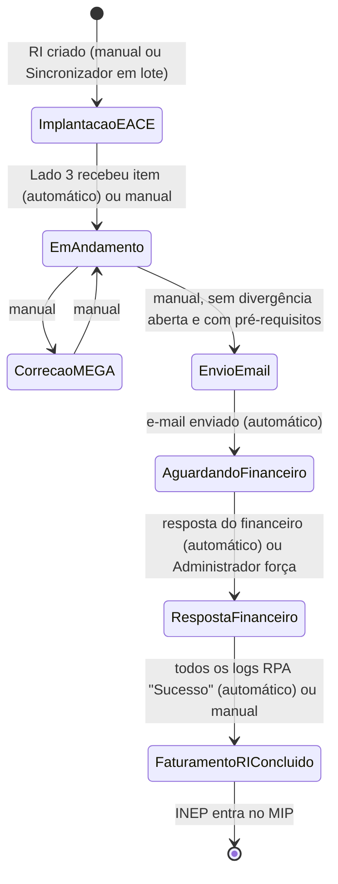
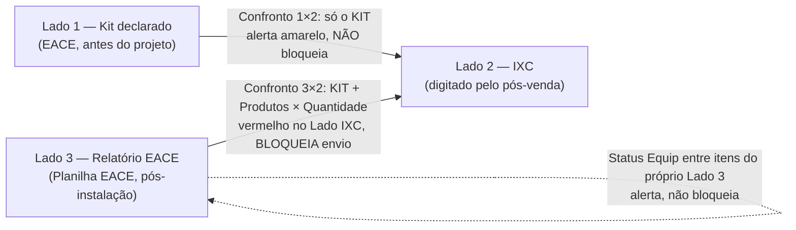
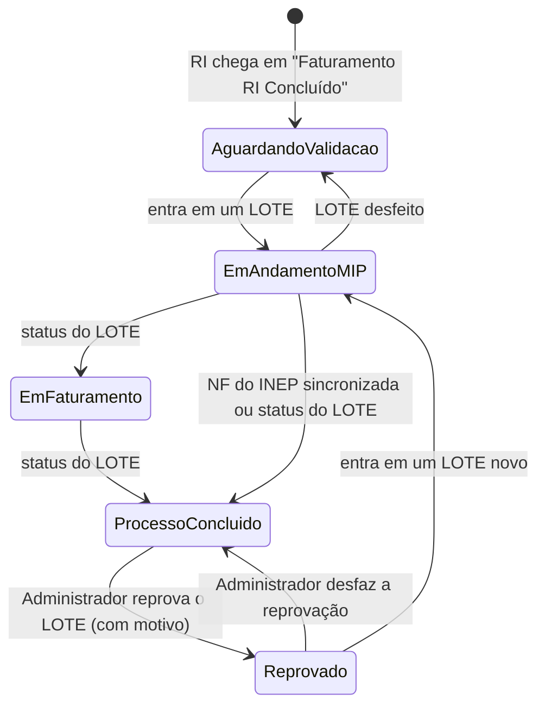

# Como funciona o Gerenciador Pós Venda

_Levantado a partir do código em 2026-10-26 (branch atual do `Sistema_posvenda`)._

Este documento descreve o sistema **como ele está implementado hoje**: integrações, dados de entrada, dados de saída, estrutura e tipos dos dados, e — com mais detalhe — as **validações dos 3 lados do RI e do MIP**. Onde o código diverge da documentação antiga (`modelo-dados.md`, `architecture.md`), vale o que está descrito aqui. As divergências encontradas estão listadas no fim, em "Pontos de atenção".

---

## 1. Visão geral

O sistema controla o **faturamento da implantação EACE por escola (INEP)**, em duas etapas encadeadas:

1. **RI (Equipamentos)**: confere o que foi instalado na escola, gera a planilha de faturamento de materiais, envia ao financeiro, recebe a Nota Fiscal (PDF + XML) e anexa a NF no portal EACE (RPA).
2. **MIP (serviço de implantação)**: depois que o RI termina, o INEP entra no MIP. Lá os INEPs são agrupados em **LOTEs** por município, é gerada a planilha de faturamento de implantação, a NFS-e do município é recebida e anexada no portal EACE (RPA do MIP).

Há também módulos de apoio: **BDO** (boletins mensais de manutenção RI/RE), **Automações IXC** (criação em massa de login e atendimentos no IXC), **Dashboards/Relatórios** e **Auditoria**.

**Pilha técnica:** Django (monólito modular), MySQL 8 (SQLite opcional em dev), HTMX no front, Playwright (Chromium) para os RPAs, `pdfplumber` para leitura de PDF, `openpyxl` para planilhas, Microsoft Graph para leitura de e-mail, SMTP para envio, LDAP/Active Directory para login.

### Apps

| App | Responsabilidade |
|---|---|
| `apps/core` | Usuário (perfis), login, home, dashboards, código de rastreio de e-mail |
| `apps/escolas` | Escola/INEP, MIP, LOTE, Notas Fiscais MIP, Validação MIP (NF), BDO |
| `apps/ri` | RI e seus 3 lados, catálogo LPU (`KitPadrao`), divergências, documentos, e-mail com o financeiro, RPA EACE do RI |
| `apps/ixc` | Telas e filas das Automações IXC |
| `apps/integracoes/eace` | RPAs do portal EACE (RI, MIP, BDO) e extração de dados de PDF/XML |
| `apps/integracoes/ixc` | Cliente HTTP da API do IXC e regras das automações |
| `apps/integracoes/ad` | Sincronização de nome/e-mail via Active Directory |
| `apps/auditoria` | Registro técnico de login, transição de status, alteração de campo, e-mail, RPA, erro |

### Perfis de usuário

| Perfil | Pode |
|---|---|
| Administrador | Tudo, inclusive excluir itens, forçar transições, reabrir "Processo Concluído", reprovar LOTE |
| Analista | Tudo, exceto excluir e as ações exclusivas do Administrador |
| Visualizador | Somente leitura (Equipamentos e MIP); POST bloqueado por middleware; totais em R$ escondidos |

---

## 2. Integrações externas

### 2.1 Portal EACE (RPA via Playwright)

Um único **worker** (`rpa_eace_worker`, comando `processar_fila_rpa_eace`, a cada `RPA_EACE_POLL_INTERVAL_SECONDS`, padrão 5 s) executa **uma coisa por vez** em todo o sistema, com 1 login no portal por vez. Prioridade em cada passada:

1. Recupera execuções órfãs (ficaram "Processando" porque o worker morreu).
2. Envio de NF: o mais antigo entre a fila do **RI** (`LogRpaEace`) e a do **MIP** (`LogRpaEaceMip`), por `enfileirado_em`.
3. Se não houver envio: **Leitura EACE do BDO** (`LeituraEaceBdo`).
4. Se nada acima: **Validação MIP (NF)** (`ValidacaoNfMip`, agendada de hora em hora das 08h às 19h ou manual).

| Rotina | Caminho no portal | Ação | Saída gravada |
|---|---|---|---|
| RPA RI | Login → perfil Fornecedor → Medições → Ver OSPs → pesquisa OSP → Notas Fiscais | Anexa **PDF + XML** na linha "Pendente" do INEP e clica "Enviar notas" | `LogRpaEace` (resultado, motivo, INEP/produto/valor do PDF, valor do portal) |
| Consulta de pendências RI | Mesmo caminho, só leitura | Lê as linhas do INEP em cada OSP do RI | `Ri.pendencias_portal_eace` (JSON) |
| RPA MIP (LOTE) | Medições → Ver MIPs → pedido de maior número (ou informado) → card do município | Anexa **só o PDF** (NFS-e) no card "Pendente" e confirma a mudança de status | `LogRpaEaceMip` |
| Validação MIP (NF) | Medições → Ver MIPs → pedido | Só leitura dos cards de município | `ValidacaoNfMip` + `CardValidacaoNfMip` (município, UF, Cód. IBGE, status, valor) |
| Leitura EACE do BDO | Boletim → seção Notas Fiscais | Só leitura dos cards | `MunicipioBdo.status_eace/valor_eace/arquivo_nf_eace` |

Configuração (`.env`): `EACE_URL`, `EACE_USUARIO`, `EACE_SENHA`, `EACE_HEADLESS`, `EACE_TIMEOUT_MS`, `EACE_DELAY_MS`.

Reprocessamento: erro de **regra de negócio** nunca reprocessa sozinho; erro **técnico** (não mapeado) volta 1 vez para o fim da fila e, na 2ª falha, vira erro definitivo.

### 2.2 E-mail com o financeiro

| Direção | Tecnologia | Detalhe |
|---|---|---|
| Envio | SMTP (`EMAIL_*`, `DEFAULT_FROM_EMAIL`) | 1 e-mail por INEP, com a planilha de faturamento anexada |
| Recebimento | Microsoft Graph, delta query (`GRAPH_FINANCEIRO_*`) | Serviço `email_scheduler` roda `sincronizar_email_financeiro` a cada `GRAPH_FINANCEIRO_POLL_INTERVAL_SECONDS` (padrão 300 s) |

- **Código de rastreio** no assunto: `#RI-AAAAMMDD-INEP - <assunto>` (regex `RI-(\d{8})-(\d{8})`). É reinserido no envio mesmo que o usuário apague do assunto.
- Destinatários sugeridos (editáveis): Para `hilber.lustosa@speedcsc.com.br`, `financeiro@speedcsc.com.br`; Cc `logistica-l@speedcsc.com.br`, `posvendas@megainfraestrutura.com.br`.
- Só conta como resposta do financeiro um remetente do domínio **`speedcsc.com.br`**.
- Cursor do Graph (`EmailFinanceiroSync.delta_link`) só avança se nenhuma mensagem falhou na passada; mensagens repetidas são ignoradas por `mensagem_id_externo`.

### 2.3 IXC (API REST)

- Cliente `IXCClient` (`IXC_URL`, `IXC_TOKEN`, autenticação `Basic` com o token em base64; header `ixcsoft: listar` nas listagens).
- Uso atual: **somente escrita em massa** a partir de planilha (não alimenta o Lado IXC do RI, que continua manual):
  - **Login (Endereços)**: `POST radusuarios`.
  - **Atendimentos**: `POST su_ticket`.
- Processadas em chunks pelo `ixc_worker` (`processar_fila_automacoes_ixc`, a cada `IXC_WORKER_POLL_INTERVAL_SECONDS`, padrão 3 s). Resultado por linha em `ExecucaoAutomacaoIxc`/`LinhaExecucaoIxc`.

### 2.4 Active Directory (LDAP)

- Login via `django_auth_ldap` (`USE_AD_AUTH`, `AD_SERVER_URI`, `AD_BIND_DN`, `AD_BIND_PASSWORD`, `AD_USER_SEARCH_BASE`, `AD_DEFAULT_DOMAIN`), com fallback para usuário local.
- No primeiro acesso, o usuário é criado como **Analista**. Após o login, nome (`displayName`/`sn`) e e-mail (`mail`/`proxyAddresses`) são sincronizados do AD, sem bloquear o login se o LDAP cair.

---

## 3. Entradas de dados

### 3.1 Arquivos

| Entrada | Onde entra | Formato | Colunas/conteúdo obrigatório | Regras de aceite |
|---|---|---|---|---|
| **Planilha EACE (RI)** | Administrador > Planilha EACE | `.csv` UTF-8, separador `;` ou `,` (detectado pelo cabeçalho) | `Projeto` (INEP), `Descrição do Item`, `Qtde Produto`, `Valor Unit UR`. Lidas também, quando existem: `Num OSP`, `Validação OSP`, `Nota Fiscal`, `Status escola` | Extensão `.csv`, decodifica UTF-8, não vazio, cabeçalho com as 4 obrigatórias. Arquivo único: um novo upload substitui o anterior |
| **Relatório EACE (MIP)** | Administrador > Relatório EACE (MIP) | `.xlsx` (qualquer aba cuja 1ª linha tenha as colunas) | `PROJETO`, `COD FORNECEDOR`, `DESCRIÇÃO DO ITEM`, `QTDE PRODUTO`, `VALOR UNIT UR`, `DATA EMISSÃO ACS` (dd/mm/aaaa), `UF`, `CIDADE` (aceita `MUNICIPIO`/`MUNICÍPIO`) | Cabeçalho normalizado (maiúsculas, espaços). Arquivo único, substitui o anterior |
| **Notas Fiscais (MIP)** | Administrador > Relatório EACE (MIP) | `.zip` ou `.rar` com PDFs de NFS-e | Cada PDF com `CÓDIGO INEPS: <INEP>/<CodFornecedor>;...` | `.zip` válido (`zipfile`) ou `.rar` válido (`rarfile`; extração exige `unar` no servidor) |
| **NF do LOTE (.zip)** | Projeto > MIP (LOTE) | `.zip`/`.rar` | Livre (só guarda para download) | Mesma validação de arquivo compactado |
| **Resposta do financeiro** | Caixa monitorada via Graph | E-mail com anexos | PDFs (NF) + XMLs, em mesma quantidade | Ver 5.4 |
| **NF corrigida "por fora"** | Tela do RI > logs RPA | PDF + XML | 1 de cada | Cria `Documento`s e um `LogRpaEace` já na fila |
| **Catálogo LPU** | Comando `importar_catalogo_lpu` (ou Django admin) | `CONSOLIDADO EACE.xlsx`, aba `LPU` | Descrição, Lote, Unidade, Equipamentos (R$), Serviços (R$) | Chave única (descrição, lote) |
| **Base de escolas** | Comandos `importar_escolas_planilha` / `importar_nova_base_eace` | `.xlsx` | INEP, nome, endereço, lote, UF, município, kit inicial, velocidade | INEP com 8 dígitos (zero à esquerda) |
| **Assinatura RE** | Comando `importar_assinatura_re` | Aba FATURAMENTO BDO do CONSOLIDADO | Valor mensal por INEP | — |
| **Base consolidada MIP** | Comando `importar_lotes_mip_em_massa` | Mesmo layout do Relatório EACE (MIP) + `Valor Liberado ACS` | — | Simulação por padrão; grava só com confirmação |
| **Boletim BDO (FR_XXXX)** | Projeto > BDO | `.xlsx` | `BOLETIM DE DESEMPENHO`, `MUNICIPIO`, `UF`, `VALOR SERVICOS`, `VALOR CREDITOS`, `VALOR DESCONTOS`, `VALOR DESCONTOS PROPORCIONAIS`, `VALOR TOTAL`, `INEPS` | Número de boletim já importado é recusado |
| **Pro rata (BDO)** | Projeto > BDO | `.xlsx` | Ativado em, Dias descontados, Valor (desconto) por INEP | — |
| **Automações IXC** | Automações IXC > Login / Atendimentos | `.xlsx` (modelos em `doc/`) | Login: `Cliente_ID`, `Login_Contrato_ID`, `Login_Login`, `Login_Senha_Cliente`, endereço (`End_*`)… Atendimento: `Cliente_ID`, `Contrato_ID`, `Assunto_ID`, `Filial_ID`, `Departamento_ID` (obrigatórios), `Tipo_Processo` | Validação por linha; linha inválida vira erro só daquela linha |

### 3.2 Digitação manual (telas)

| Tela | Campo | Tipo | Validação |
|---|---|---|---|
| RI > Lado IXC | KIT Instalado | Escolha do catálogo (Unidade "Escola…", filtrado pelo Lote da escola) ou "Outro" + nº de Access Points (inteiro ≥ 1) | Máximo 1 KIT por RI |
| RI > Lado IXC | Produtos (botão "+") | Produto do catálogo (só itens com valor de equipamento) + Quantidade (inteiro ≥ 1) | — |
| RI > Lado IXC | Itens só com valor de serviço ("+") | Produto do catálogo sem valor de equipamento + Quantidade | — |
| RI > Lado IXC | Data de Ativação | Data | Opcional ao salvar |
| RI > Lado IXC | Mês da Operação | 1–12 (nasce no mês corrente) | Opcional ao salvar |
| RI > Lado IXC | Município (IXC) | Texto ≤ 150 (nasce com o da Escola) | Opcional ao salvar |
| RI > Lado IXC | Estado (IXC) | UF, 2 letras, gravado em maiúsculas | Rejeita formato inválido |
| RI > Lado IXC | CNPJ / CNPJ Fictício | Texto ≤ 20 | Sem validação de dígito |
| RI > Lado Relatório EACE | KIT / Produtos | Mesmo mecanismo do Lado IXC | Máximo 1 KIT |
| RI > E-mail | Para, Cc, Assunto, Mensagem, Anexo extra | E-mails separados por `,` ou `;` | Para obrigatório e e-mails válidos |
| RI / MIP > Histórico | Mensagem (≤ 250) e/ou anexo | Texto / arquivo | Pelo menos um dos dois |
| MIP > Criar LOTE | Estado, Município, Data início/fim, INEPs marcados, rateio manual | Texto, data, lista de IDs, Cidade + valor | Ver 6.5 |

---

## 4. Modelo de dados (tipos)

Convenções de tipo usadas abaixo: **Texto(n)** = string com tamanho máximo; **Inteiro+** = inteiro positivo; **Decimal(10,2)** = valor monetário; **Data**, **Data/hora**, **Booleano**, **JSON**, **Arquivo**.

### 4.1 `Escola` (o INEP)

| Campo | Tipo | Observação |
|---|---|---|
| `inep` | Texto(8), único | Sempre 8 dígitos, preserva zero à esquerda |
| `nome` | Texto(255) | |
| `endereco` | Texto(255) | |
| `lote` | Inteiro+ | Lote do **catálogo** (faixa de preço). Não é o LOTE do MIP |
| `estado` / `municipio` | Texto(2) / Texto(150) | |
| `kit_inicial` | Texto(100) | Kit declarado pela EACE: texto completo ou só o nº de Access Points (ex.: "4") |
| `nobreak_inicial` | Texto(100), padrão "Nobreak" | |
| `velocidade_dl_minima` | Texto(50) | |
| `valor_assinatura_re` | Decimal(14,2) | Só conferência no BDO |
| `status_conexao` | `desconectado` / `parcialmente_conectado` / `conectado` | Calculado pelas datas de instalação RE/RI |
| `data_instalacao_re` / `data_instalacao_ri` | Data | |
| `status_mip` | Nulo ou `aguardando_validacao_eace`, `em_andamento`, `em_faturamento_lote`, `faturamento_concluido` ("Processo Concluído"), `reprovado` | Nulo = nunca entrou no MIP |
| `encontrado_relatorio_eace_mip` | Booleano (nulo = nunca sincronizado) | INEP veio na última sincronização do Relatório EACE (MIP) |
| `cod_fornecedor` | Texto(20) | Da planilha do MIP |
| `retirado_grid_mip` / `pausado_mip` | Booleano | Controles do grid do MIP |
| `legado` | Booleano | RI importado do histórico anterior ao sistema |

### 4.2 `Ri` (cabeçalho do faturamento de equipamentos)

| Campo | Tipo | Observação |
|---|---|---|
| `escola` | FK Escola | Um INEP pode ter vários RIs; vale sempre o **mais recente** |
| `responsavel` | FK Usuário | |
| `status` | `implantacao_eace`, `andamento`, `envio_email_faturamento`, `aguardando_financeiro`, `aguardando_anexo_portal_eace` ("Resposta Financeiro"), `faturamento_ri_concluido`, `correcao_mega` | Ver 5.1 |
| `data_ativacao` | Data | Lado IXC |
| `mes_operacao_ixc` | Inteiro 1–12 | Lado IXC |
| `municipio_ixc` / `estado_ixc` | Texto(150) / Texto(2) | Lado IXC |
| `cnpj` / `cnpj_ficticio` | Texto(20) | Lado IXC |
| `observacoes_envio_financeiro` | Texto longo | Mensagem do e-mail |
| `dados_financeiro_confirmados_em` / `concluido_em` | Data/hora | |
| `pendencias_portal_eace` | JSON (lista de `{status, descricao, valor, osp}`) | Última consulta ao portal |
| `kit_informado_ixc` / `divergencia_kit` | Texto / Booleano | **Sem uso** (legado) |

### 4.3 Os 3 lados do RI

| Campo | Lado 1 `RiItemEace` (Kit declarado) | Lado 2 `RiItemIxc` (IXC) | Lado 3 `RiItemRelatorioEace` (Relatório EACE) |
|---|---|---|---|
| `descricao_item` | Texto(255) | Texto(255) — descrição curta do catálogo | Texto(255) — descrição curta do catálogo |
| `quantidade` | Inteiro+ | Inteiro+ (KIT = 1) | Inteiro+ (KIT = 1) |
| `valor_unitario` | Decimal(10,2) | Decimal(10,2) — **nasce 0,00**; o valor real vem do catálogo na hora de calcular | Decimal(10,2) — **valor de equipamento** do catálogo no momento do lançamento |
| `eh_kit` | — (sempre é o kit) | Booleano | Booleano |
| `num_osp`, `validacao_osp`, `nota_fiscal`, `status_escola` | — | — | Texto(50) cada, preenchidos **só** pelo Sincronizador |
| `origem_sincronizador` | — | — | Booleano |
| Quem lança | Só Django admin (não há tela) | Usuário (Admin/Analista) | Sincronizador (Planilha EACE) ou usuário |

### 4.4 Lado 3 do MIP — `EscolaItemRelatorioEaceMip`

Tabela própria, por Escola (não por RI). Nunca se mistura com o Lado 3 do RI.

| Campo | Tipo |
|---|---|
| `escola` | FK Escola |
| `descricao_item` | Texto(255) |
| `quantidade` | Inteiro+ |
| `valor_servico` | Decimal(10,2), pode ser nulo |
| `eh_kit` | Booleano |
| `uf` / `cidade` | Texto(2) / Texto(150) |
| `data_emissao_acs` | Data |

### 4.5 Catálogo `KitPadrao` (LPU)

| Campo | Tipo | Uso |
|---|---|---|
| `descricao` | Texto(255) | Chave única junto com `lote` |
| `descricao_curta` | Texto(255) | Descrição sem o "(...)" final; é o texto gravado nos itens |
| `numero_access_points` | Inteiro+ | Extraído de "N Access Points"; casa KITs |
| `lote` | Inteiro+ | Faixa de preço (casa com `Escola.lote`) |
| `unidade` | Texto(50) | "Escola"/"Escola/Mês" = KIT; demais = produto avulso |
| `valor_equipamento` | Decimal(10,2) | **Usado pelo RI** (`valor_faturavel`) |
| `valor_servico` | Decimal(10,2) | **Usado pelo MIP** |
| `aba_planilha_financeiro` | Texto(50) | Agrupa produtos numa aba da planilha do RI |

### 4.6 Demais tabelas

| Tabela | Principais campos (tipo) |
|---|---|
| `RiDivergencia` | `tipo` (`valor`/`quantidade`/`kit_relatorio`/`nf_financeiro`), `bloqueia` (Booleano), `descricao` (Texto), `resolvida_em` (Data/hora). Hoje só `kit_relatorio` é gerado |
| `Documento` | `tipo` (`nota_fiscal_pdf`/`xml`), `arquivo`, `versao` (Inteiro+), `ativo`, `recebido_em` |
| `LogRpaEace` | `resultado` (`pendente`/`na_fila`/`processando`/`sucesso`/`erro`/`cancelado`), `motivo_erro`, `documento_pdf`/`documento_xml` (FK), `inep_pdf`, `produto_pdf`, `valor_pdf`, `valor_portal` (Texto), `tentativas`, `enfileirado_em`, `executado_em`, `etapa_atual`, `progresso_pct`, `concluido_manualmente`, `criado_manualmente`, `motivo_cancelamento` |
| `RiHistorico` | `tipo` (`mensagem`/`anexo`/`log_status`/`log_campo`/`email`/`validacao_nf`/`importacao_massa`), `autor`, `mensagem` (≤ 250), `anexo`, `documentos` (M2M), `campo`, `valor_anterior`, `valor_novo`, `resultado_validacao_nf` (JSON). **Compartilhado entre RI e MIP** |
| `EmailFinanceiroLog` | `direcao` (`enviado`/`recebido`), `remetente`, `destinatarios`, `assunto`, `anexo_pdf`, `status_leitura` (`ok`/`fora_do_padrao`), `mensagem_id_externo` |
| `PlanilhaEace` / `PlanilhaRelatorioEaceMip` / `NotasFiscaisMip` | Arquivo ativo único (singleton), quem enviou e quando; no MIP também `sincronizacao_confirmada` e período |
| `Lote` | `estado`, `municipio`, `data_inicio`/`data_fim`, `escolas` (M2M), `status` (`em_andamento`/`em_faturamento`/`faturamento_concluido`/`reprovado`), `arquivo_notas_fiscais_zip`, `importado_em_massa`, `valores_faturados_planilha` (JSON `{INEP: "valor"}`), `rateio_manual` (JSON `{INEP: [{cidade, valor}]}`), `motivo_reprovacao` |
| `NotaFiscalMip` | `escola` (FK), `arquivo`, `nome_original`, `sincronizada_em`, `lote_reprovado` (FK, nulo = NF vigente) |
| `LogRpaEaceMip` | `lote`, `nota_fiscal`, `municipio`, `resultado`, `motivo_erro`, `valor_pdf`, `valor_portal`, `status_portal`, `pedido` |
| `ValidacaoNfMip` / `CardValidacaoNfMip` | Execução (status, origem `agendada`/`manual`, pedido) e cards lidos (município, UF, IBGE, status, valor Decimal(14,2)) |
| BDO | `BoletimBdo`, `MunicipioBdo` (5 valores Decimal(14,2) + dados lidos do portal), `InepBdo` (dados da Pro rata, status da divergência `APROVADO`/`CONTESTADO`), `MedicaoBdo`, `PrimeiroFaturamentoInep`, `LogStatusDivergenciaBdo` |

---

## 5. Fluxo do RI (Equipamentos)

### 5.1 Ciclo de status do RI

Regras de transição manual (`_validar_transicao_status_ri`):

- INEP já no MIP (`Escola.status_mip` preenchido): o status do RI **não muda mais por aqui** — fica "Faturamento RI Concluído" e quem manda é o Status (MIP).
- De "Implantação EACE", só para "Em Andamento".
- "Aguardando financeiro" e "Resposta Financeiro" são automáticos; única exceção: Administrador força "Aguardando financeiro" → "Resposta Financeiro".
- "Correção MEGA" só a partir de "Em Andamento", e só volta para "Em Andamento".
- "Em Andamento" → "Envio de Email para faturamento" é **bloqueado** se houver `RiDivergencia` aberta com `bloqueia=True`. A opção só aparece no select se, além disso, os pré-requisitos da planilha estiverem completos (ver 5.3).
- "Faturamento RI Concluído" manual só a partir de "Resposta Financeiro" e só se nenhum log de RPA estiver fora de "Sucesso"/"Cancelado".
- Com o faturamento encerrado (MIP em "Processo Concluído"), só o Administrador altera o RI.

Ao chegar em "Faturamento RI Concluído", `Ri.save()` grava `Escola.status_mip = "aguardando_validacao_eace"` (se o INEP ainda não estava no MIP). Esse é o **handoff RI → MIP**.

### 5.2 Validações dos lados do RI

#### Lado 1 — Kit declarado

- **Origem:** `Escola.kit_inicial` (+ `Escola.lote`). Itens `RiItemEace` só existem se lançados pelo Django admin; sem item, a tela mostra uma **referência calculada** a partir do catálogo.
- **Resolução no catálogo** (`KitPadrao.resolver_kit_declarado`):
  - `kit_inicial` só com dígitos (ex.: "4") → procura `numero_access_points = 4`;
  - texto → procura `descricao` idêntica;
  - sempre restrito ao `lote` da escola; sem correspondência, mostra o texto bruto (nenhum valor inventado).
- **Total do Lado 1:** soma dos itens lançados (quantidade × valor; item com valor 0 usa o valor de equipamento do catálogo) ou, sem item, o `valor_equipamento` do kit resolvido.

#### Lado 2 — IXC

- **Origem:** digitação do usuário (Admin/Analista), editável **em qualquer status** do RI; com faturamento encerrado, só Administrador. Exclusão de item: só Administrador.
- **Regras de lançamento:**
  - KIT e produtos vêm do catálogo `KitPadrao` filtrado pelo `Escola.lote`.
  - KIT: quantidade fixa 1; **no máximo 1 KIT por RI**; opção "Outro" grava "Kit Cobertura Wi-Fi - N Access Points".
  - Produto comum: só aparece no select se tiver `valor_equipamento` no catálogo.
  - Itens "só serviço" (sem valor de equipamento): bloco próprio, entram como `RiItemIxc` normais (usados pelo MIP).
  - `valor_unitario` nasce **0,00**; nos totais e na planilha o valor vem do catálogo (`valor_equipamento`).
  - Município, Estado (UF 2 letras), CNPJ, CNPJ Fictício, Data de Ativação e Mês da Operação são opcionais **ao salvar**; só são exigidos ao gerar a planilha/enviar o e-mail.
- **Toda alteração** grava `RiHistorico` (log_campo) + `Auditoria` e **recalcula o confronto 3×2**.

#### Lado 3 — Relatório EACE (RI)

- **Origem:** Sincronizador da Planilha EACE (individual na tela do RI ou "Sincronizar todas as RI") ou lançamento manual. Bloqueado (os dois perfis) quando o faturamento está encerrado.
- **Casamento da linha da planilha com o catálogo** (`casar_planilha_eace_com_catalogo`):
  - Descrição contém "N Access Points" → é **KIT**, casa por `numero_access_points` no `lote` da escola;
  - senão → **produto avulso**: a `descricao_curta` do catálogo precisa ser **prefixo** (sem diferenciar maiúsculas) da descrição da planilha (ex.: "Kit … - Equip - MEGA - CO" aceita sufixos).
  - Sem correspondência → linha vai para "sem correspondência no catálogo" (não lança).
- **Quantidade:** KIT sempre 1; produto lê `Qtde Produto` (aceita vírgula decimal; inválida/≤ 0 → "quantidade inválida", não lança).
- **Valor unitário gravado:** `valor_equipamento` do catálogo (o "Valor Unit UR" da planilha **não é usado**).
- **Campos fechados** (Num OSP, Validação OSP, Nota Fiscal, Status escola): vêm da linha; numa nova sincronização são atualizados se vierem preenchidos e diferentes (coluna vazia nunca apaga valor já gravado).
- **Duplicidade:**
  - KIT: no máximo 1 por RI; KIT diferente do já lançado é ignorado ("KIT ignorado").
  - Produto: chave **Descrição + Num OSP** (2 linhas iguais com OSPs diferentes viram 2 itens). Item manual (sem OSP) é "confirmado" pela 1ª linha real da mesma descrição.
- **Modo "a última planilha é a verdade"** (RI fora de "Implantação EACE"/"Em Andamento"):
  - item com mesma descrição é **atualizado** se a quantidade/valor mudou;
  - item que veio do Sincronizador e **não está mais na planilha é removido**; item manual nunca é removido;
  - tudo vai para o histórico (antes/depois).
  - Em "Implantação EACE"/"Em Andamento" o Sincronizador só soma, nunca remove.
- **Efeitos colaterais:** recalcula o confronto 3×2; se o RI está em "Implantação EACE" e o Lado 3 ficou com itens, avança para "Em Andamento".
- **Sincronizar todas as RI:** usa o RI mais recente de cada escola; escola sem RI mas com linha na planilha ganha RI novo ("Implantação EACE"); RI com faturamento encerrado é pulado.

#### Confronto 1 × 2 (Kit declarado × IXC) — informativo

- Compara **somente a descrição do KIT** (Lado 1 resolvido × item `eh_kit` do Lado 2), ignorando maiúsculas e espaços nas pontas.
- Só acusa se os dois lados têm valor. Calculado na hora de exibir; **não grava `RiDivergencia` e não bloqueia nada**.

#### Confronto 3 × 2 (Relatório EACE × IXC) — formal e bloqueante

Implementado em `comparar_kit_e_produtos_ixc_relatorio` e persistido por `sincronizar_divergencia_kit_relatorio`:

1. Se **algum dos dois lados está vazio**, não há divergência.
2. **KIT:** diverge se só um lado tem KIT, ou se as descrições dos KITs são diferentes.
3. **Produtos (não KIT):** cada lado vira uma "cesta" `{descrição: soma das quantidades}`; diverge toda descrição cuja soma é diferente entre os lados (inclusive produto que só existe de um lado).
4. **Valor unitário NÃO é comparado** (o Lado IXC nasce 0,00).
5. Resultado: mantém **1 único** `RiDivergencia(tipo="kit_relatorio", bloqueia=True)` aberto por RI, com texto do tipo `"KIT Instalado — Lado IXC: X / Relatório EACE: Y. Nobreak — Lado IXC: 1 un. / Relatório EACE: 2 un."`. Sem divergência, marca `resolvida_em`.
6. Na tela, os itens divergentes do Lado IXC ficam em vermelho; o grid de Equipamentos tem card/filtro "Com divergência".
7. Recalculado após: salvar Lado IXC, salvar Lado 3, editar/excluir item de qualquer um dos dois, Sincronizador, ações no MIP que mexem no Lado IXC, comandos de correção.

#### Outras validações do RI

| Validação | Regra | Efeito |
|---|---|---|
| Município/Estado IXC × cadastro da Escola | Comparação sem caixa/espaços, só se os dois preenchidos | Alerta visual |
| Status Equip (Lado 3) | Itens do Lado 3 com mais de um valor distinto de `status_escola` | Todos os itens do Lado 3 em vermelho; não bloqueia |
| 1 KIT por INEP | Lado 2 e Lado 3 | Recusa o lançamento |
| Faturamento encerrado | `Ri.status = faturamento_ri_concluido` **e** `Escola.status_mip = faturamento_concluido` | Lado 3 bloqueado para todos; Lado IXC, status, responsável e RPA só Administrador |

### 5.3 Planilha de faturamento do RI e envio ao financeiro

**Pré-requisitos** (`itens_faltando_para_planilha_faturamento`), todos exigidos de uma vez:

- ao menos 1 item no Lado IXC **e** um deles marcado como KIT;
- Data de Ativação, Município (IXC), Estado (IXC), CNPJ e CNPJ Fictício preenchidos;
- ao menos 1 item no Lado 3 (é dele que vêm as abas e o Num OSP).

**Saída:** cópia de `doc/FATURAMENTO MATERIAS EACE.xlsx`, nome `FATURAMENTO MATERIAS EACE - <INEP> - <escola>.xlsx`:

- **1 aba por (tipo de equipamento × Num OSP)** a partir do **Lado 3**: KIT → aba fixa "NF KIT" com texto "KIT N"; produto → aba `aba_planilha_financeiro` do catálogo ou o nome do próprio produto (aba criada se não existir). Se o mesmo tipo tem mais de uma OSP, cada OSP ganha aba com sufixo " - OSP <n>".
- Células: `A20` "OPERAÇÃO COMPRA E VENDA - <MÊS>/<ANO>" (mês do Lado IXC, ano corrente); `E10` vencimento (hoje + 30 dias); `F10` observações da NF (INEP, ITEM LPU, MUNICÍPIO/UF, VENCIMENTO substituídos no texto-modelo); `H10` valor (Σ quantidade × `valor_equipamento`); `A16` CNPJ; `B16` CNPJ Fictício; `C16` escola; `F16` endereço; `G16` município IXC; `H16` UF IXC; `I16` equipamento (com "(qtd)" para produto com mais de 1 unidade).

**Envio** (só com RI em "Envio de Email para faturamento"): gera a planilha (bloqueia se faltar algo), envia SMTP com assunto contendo o código de rastreio, grava `EmailFinanceiroLog`, `Auditoria`, `RiHistorico` (com a planilha anexada) e muda o RI para "Aguardando financeiro".

### 5.4 Recebimento da resposta do financeiro

Para cada mensagem nova na caixa (`_processar_mensagem`):

| Verificação | Se falhar |
|---|---|
| Mensagem já processada (`mensagem_id_externo`) | Ignora ("duplicado") |
| Código `RI-AAAAMMDD-INEP` no assunto | Ignora, alerta no log ("sem código") |
| Existe RI para o INEP | Ignora, alerta ("sem RI") |
| Remetente do domínio `speedcsc.com.br` | Ignora, alerta ("remetente não reconhecido") — não altera nada |
| **Quantidade de PDF = quantidade de XML e ≥ 1** | Registra como "fora do padrão": **não salva** os arquivos nem cria logs de RPA |

No padrão: salva cada PDF/XML como `Documento` (sem desativar os anteriores), cria **1 `LogRpaEace` "Pendente" por PDF**, grava `EmailFinanceiroLog` e uma entrada `RiHistorico` tipo "E-mail" com os documentos. O RI vai para "Resposta Financeiro" **somente se** estava em "Aguardando financeiro" (em qualquer outro status os arquivos são guardados e o status é mantido).

### 5.5 Botão "Validar Notas Fiscais" (NF × Lado 3)

Confere os PDFs vigentes (último e-mail do financeiro + logs manuais, sem os de logs cancelados) contra o **Lado 3 do RI**. **Não bloqueia** nada; o resultado vai para o histórico (só grava se mudou desde a última validação).

1. PDF ilegível → divergência.
2. Sem número da NF ou sem itens de produto no PDF → divergência.
3. Casa a NF com itens do Lado 3 pelo campo `nota_fiscal` = número da NF. Se nenhum, tenta pelo **ITEM LPU** entre itens sem NF vinculada, **só se houver exatamente 1 candidato** (gera aviso).
4. Compara: **quantidade** total (exata), **valor total** (tolerância R$ 0,01), **valor unitário** (só no caso 1 item × 1 item), **ITEM LPU** esperado e presença do **CNPJ da EACE (45.726.363/0001-47)**.

### 5.6 RPA EACE do RI (anexar NF no portal)

**Disparo:** o usuário escolhe 1 PDF + 1 XML do RI em cada log e clica "Processar" (vai para a fila). Recusado se: faturamento encerrado e não é Administrador; log já "Sucesso"; falta PDF ou XML; RI sem nenhum `Num OSP` no Lado 3.

**Escolha da OSP** (`_resolver_osp_da_nota_fiscal`): 1 OSP → usa; várias → casa o valor do PDF com `valor_unitario × quantidade` de cada item do Lado 3; valor lido mas sem casar e OSPs diferentes → sem OSP (erro, não arrisca).

**Validações antes de abrir o portal:**

| Motivo | Regra |
|---|---|
| `pdf_ilegivel` | PDF sem texto/arquivo ausente (técnico, reprocessa 1 vez) |
| `pdf_sem_inep` | Sem "INEP: nnnnnnn(n)" |
| `pdf_sem_valor` | Sem "Valor Total da Nota" |
| `inep_divergente_do_pdf` | INEP do PDF ≠ INEP do RI |
| `pdf_sem_cnpj_eace` / `xml_sem_cnpj_eace` | CNPJ da EACE ausente no PDF ou no XML |
| `credenciais_ausentes` | `.env` sem usuário/senha do portal |

**Validações no portal:**

| Motivo | Regra |
|---|---|
| `osp_nao_encontrada` | Portal mostra 0 pedidos para a OSP |
| `inep_nao_encontrado` | INEP não aparece no grid da OSP |
| `documento_ja_enviado` | Nenhuma linha "Pendente" para o INEP |
| `valor_divergente` | Nenhuma linha "Pendente" com valor igual ao do PDF (tolerância R$ 0,01) |
| `valor_ambiguo` | 2+ linhas "Pendente" com o mesmo valor — não escolhe sozinho |
| `upload` / `enviar_notas` / `login` / etapas de navegação / `erro_playwright` | Falhas técnicas |

**Conclusão:** "Sucesso" em todos os logs (com ao menos 1 "Sucesso"; "Cancelado" não conta) → RI vai sozinho de "Resposta Financeiro" para "Faturamento RI Concluído". Alternativas: "Marcar como concluído manualmente" (NF anexada por fora), "Cancelar" (NF errada, motivo obrigatório) e "Processamento manual" (NF corrigida enviada por fora do e-mail).

---

## 6. Fluxo do MIP (serviço de implantação)

### 6.1 Ciclo de status do MIP (por INEP e por LOTE)

- "Em Andamento MIP", "Em Faturamento" e "Reprovado" **nunca** são escolhidos manualmente no INEP; vêm do LOTE.
- INEP dentro de um LOTE (não reprovado) só muda de status **pelo LOTE**.
- A partir de "Processo Concluído", só o Administrador muda (INEP ou LOTE).
- Qualquer Status (MIP) mantém o RI em "Faturamento RI Concluído".

### 6.2 Quem aparece no grid do MIP

`escolas_no_grid_mip`: INEP que **veio no Relatório EACE (MIP)** (qualquer status) **ou** está em "Aguardando Validação EACE"/"Reprovado", **menos** os retirados pelo "X" e os que já estão em LOTE ativo. A primeira sincronização de uma planilha nova traz de volta os retirados e retoma os pausados.

**Bolinha:** verde quando o INEP veio na última sincronização **e** tem item no Lado 3; vermelha nos demais casos.

### 6.3 Os 3 lados no MIP

Diferença central em relação ao RI: **o MIP trabalha com `valor_servico` do catálogo**, nunca com o valor de equipamento.

| Lado | Origem no MIP | Editável no MIP? |
|---|---|---|
| **Lado 1 — Kit declarado** | Mesmos itens do RI (`RiItemEace`) ou referência pelo `kit_inicial`; valor = `valor_servico` do KIT no catálogo | Não |
| **Lado 2 — IXC** | Mesmos itens do RI atual (`RiItemIxc`); valor = `valor_servico` resolvido por `KitPadrao.resolver_por_item` (KIT pelo nº de Access Points; produto pela descrição curta exata) | Só com status "Aguardando Validação EACE": adicionar itens "só serviço" (Admin/Analista) e excluir produto avulso (só Administrador; KIT nunca) |
| **Lado 3 — Relatório EACE (MIP)** | `EscolaItemRelatorioEaceMip`, vindo do Sincronizador do MIP | Não (só pela planilha) |
| Lado 3 do RI (comparação visual) | Itens do Lado 3 do RI com `valor_servico`, mostrados acima do Lado 3 do MIP quando o status é "Aguardando Validação EACE" | Não; não entra em nenhum cálculo |

### 6.4 Sincronizador do Lado 3 do MIP

Botão "Sincronizar todos os INEPs" (Administrador > Relatório EACE (MIP)), para **toda** escola:

- Marca `encontrado_relatorio_eace_mip` (veio ou não nesta planilha) e grava `cod_fornecedor` (só se vier preenchido).
- **Mesmo casamento descrição × catálogo do RI** (KIT por nº de Access Points; produto por prefixo da descrição curta), restrito ao `Escola.lote`. Sem correspondência ou quantidade inválida → linha ignorada.
- Quantidade: KIT = 1; produto = `QTDE PRODUTO` (número > 0).
- Grava `valor_servico` do catálogo, UF, Cidade e Data Emissão ACS (dd/mm/aaaa; formato inválido vira nulo).
- **A última planilha é sempre a verdade**: descrição presente → cria/atualiza; descrição ausente → **remove** (não há lançamento manual a proteger).
- 1 KIT por INEP: um KIT diferente do existente é ignorado e o existente fica protegido.
- Opção "não sobrepor": INEP que já tem Lado 3 é pulado inteiro (a pergunta aparece uma vez por arquivo novo).
- Cada mudança vai para o histórico do RI atual (antes/depois), quando há usuário e RI.

### 6.5 Validações do MIP

#### Confronto de Valor de serviço 2 × 3 (IXC × Relatório EACE MIP)

`_comparar_valor_servico_ixc_relatorio_mip`, calculado na hora (não grava tabela):

1. Algum dos lados vazio → sem divergência.
2. **KIT:** diverge se só um lado tem KIT, ou se o `valor_servico` do KIT do IXC (do catálogo) ≠ `valor_servico` gravado no KIT do Lado 3.
3. **Produtos:** monta `{descrição: valor_servico unitário}` de cada lado; diverge toda descrição cujo valor é diferente ou que existe só de um lado.
4. **Quantidade não é comparada item a item** (ver totais abaixo).
5. Itens divergentes ficam em vermelho **nos dois lados**; card/filtro "Com divergência" no grid.

#### Totais por lado

`_valor_total_itens`: Σ quantidade × `valor_servico`. Item sem `valor_servico` não entra na soma, mas marca o total como **incompleto**. Sem itens → sem total (nulo, não zero).

- **Valor Total (IXC)** × **Valor Total (EACE)**: se os dois existem e são diferentes, o total EACE aparece em **amarelo** no grid. Aqui é onde diferença de **quantidade** aparece.
- Linha de total geral soma os INEPs que passaram pelos filtros.
- O Lado 1 tem total exibido, mas **não participa de nenhuma comparação** no MIP.

#### Elegibilidade para LOTE (`escolas_elegiveis_lote_mip`)

Um INEP só entra num LOTE se **todas** as condições valem:

1. Estado e Município informados e iguais aos da escola (comparação exata).
2. `status_mip` = "Aguardando Validação EACE" ou "Reprovado".
3. Não está pausado no MIP.
4. Não está em outro LOTE não reprovado.
5. Veio no Relatório EACE (MIP) (`encontrado_relatorio_eace_mip = True`) — desligado só na importação em massa.
6. Se informadas, Data de Ativação do RI atual dentro de [Data início, Data fim] (RI sem data some do filtro).
7. **Valor Total (IXC) e Valor Total (EACE) existem, estão completos e são iguais.**

#### Criação do LOTE (`criar_lote_mip`)

- Erros (nada é gravado): sem Estado/Município; data inicial > final; nenhum elegível; nenhum INEP marcado no modal. IDs recebidos são sempre cruzados com os elegíveis (POST manipulado não inclui INEP inelegível).
- **Rateio manual** (por INEP): só para INEP **sem** rateio automático por Cidade; mínimo 2 partes; Cidade obrigatória, ≤ 150 caracteres, sem `/ \ : * ? " < > | [ ]`; valor > 0 com no máximo 2 casas; **soma das partes = Valor Total (IXC) do INEP**.
- Efeito: LOTE nasce "Em Andamento MIP"; cada INEP vai para "Em Andamento MIP" com 2 entradas no histórico (status e número do LOTE). Tudo em uma transação.
- **Rateio automático**: INEP cujos itens do Lado 3 têm 2+ Cidades preenchidas diferentes (ex.: "Brasília" e "Brasília2").

#### Desfazer / reprovar LOTE

- Desfazer: só com LOTE "Em Andamento" (ou antigo "Aguardando Encerramento") e nenhum INEP em "Processo Concluído"; INEPs voltam para "Aguardando Validação EACE" e o LOTE é excluído.
- Reprovar: só Administrador, só LOTE em "Processo Concluído", motivo obrigatório; NFs ficam guardadas no LOTE reprovado e o INEP fica livre para LOTE novo.
- Desfazer reprovação: recusado se algum INEP já entrou em LOTE mais novo.

### 6.6 Planilha de faturamento de implantação (saída do MIP)

Modelo `doc/FATURAMENTO IMPLANTAÇÃO.xlsx`, gerado por LOTE:

- **Valor (`H10`)** = Σ Valor Total (IXC) dos INEPs (escola sem item soma 0); LOTE importado em massa usa o valor faturado da planilha.
- `F10`: MUNICIPIO/UF, VENCIMENTO e **CÓDIGO INEPS** = `INEP/CodFornecedor` de cada INEP separados por `;`.
- `E10`: vencimento = data de envio + 30 dias; `A13`: "OPERAÇÃO REDE INTERNA/IMPLANTAÇÃO - <MÊS>/<ANO>" do momento da geração; aba renomeada com o município.
- **Rateio:** 1 planilha para o município do LOTE + 1 por Cidade extra (rateio automático usa a fração do Lado 3 por Cidade; rateio manual usa as partes informadas, somadas por Cidade).

### 6.7 Notas Fiscais do MIP e RPA do LOTE

**Sincronizar Notas Fiscais dos INEPs:** lê cada PDF do `.zip/.rar` ativo, extrai os INEPs de "CÓDIGO INEPS", e grava o PDF em cada INEP que está em LOTE "Em Andamento" (NF com mesmo nome substitui; nome novo adiciona — INEP rateado pode ter várias). INEP que recebeu NF vai para **"Processo Concluído"**. PDF sem "CÓDIGO INEPS" é contado e ignorado.

**Envio ao portal (por LOTE)** — `notas_fiscais_do_lote` decide quais NFs vão:

- INEPs sem rateio manual: precisa existir **exatamente 1 NF comum a todos** (comparação pelo nome do arquivo, ignorando espaço/"_" e caixa). Falha com "INEP sem NF", "nenhuma NF comum" ou "N NFs comuns".
- Com rateio manual: precisa haver **1 NF por Cidade** do rateio.
- Recusa enfileirar se: LOTE reprovado; envio já na fila; todas as NFs já enviadas (ou card já não estava "Pendente").

**Validações do RPA MIP:**

| Motivo | Regra |
|---|---|
| `pdf_ilegivel` / `pdf_sem_valor` | PDF sem texto / sem valor da NFS-e |
| `pedidos_nao_encontrados` / `pedido_nao_encontrado` | Grid de MIPs vazio / pedido informado não existe |
| `municipio_nao_encontrado` | Nenhum card do município (tenta o nome exato e, para "São Paulo1", o município principal) |
| `documento_ja_enviado` | Nenhum card "Pendente" no município, ou a NF não bate com o pedido atual mas já aparece enviada (mesmo valor) em um dos até 4 pedidos anteriores |
| `valor_divergente` | Nenhum card "Pendente" com valor igual ao do PDF (tolerância R$ 0,01) |
| `valor_ambiguo` | 2+ cards "Pendente" com o mesmo valor |
| `envio_nao_confirmado` | PDF anexado, mas o card não mudou para "Aguardando Aprovação"/"Aprovado"/"NF anexada" — **não reprocessa** para não anexar 2 vezes |

### 6.8 Importação em massa de LOTEs

Comando `importar_lotes_mip_em_massa` (planilha "BASE CONSOLIDADA MIP"; simula por padrão). Por INEP: não cadastrado, já em LOTE ou pausado → fora. Precisa estar em "Aguardando Validação EACE" e com **Total IXC = Total EACE = total da planilha (Valor Liberado ACS)**; se o Lado 3 estiver vazio e Total IXC = planilha, preenche o Lado 3 com as linhas da planilha (desfaz se o total não fechar). Com `--incluir-divergentes`, quem falha entra mesmo assim valendo o valor da planilha. Um LOTE por Estado+Município (grafias diferentes do município são unificadas), criado já em "Processo Concluído", com histórico "Importação em massa" em cada INEP.

---

## 7. Saídas do sistema

| Saída | Formato | Conteúdo | Destino |
|---|---|---|---|
| Planilha de faturamento de materiais (RI) | `.xlsx` | Ver 5.3 | Anexo do e-mail ao financeiro / download |
| E-mail ao financeiro | SMTP | Assunto com código de rastreio, corpo com itens do Lado IXC e total, planilha + anexo extra | Financeiro (speedcsc) |
| NF + XML no portal EACE (RI) | Upload via RPA | PDF + XML na linha da OSP/INEP | Portal EACE |
| Planilha de faturamento de implantação (MIP) | `.xlsx` (ou `.zip` com várias) | Ver 6.6 | Download por LOTE |
| NFS-e no portal EACE (MIP) | Upload via RPA | PDF no card do município | Portal EACE |
| Relatório Faturamento EACE Materiais | Tela, `.xlsx`, `.zip` com NFs | LOTE, UF, município, INEP, escola, endereço, velocidade, kit estimado/instalado, AP adicional, nobreak, conversor, rack, switch, valor de equipamentos, status, data de ativação, NF por tipo de equipamento, OSPs, observação | Download |
| Relatório Faturamento EACE Materiais (novo) | Tela, `.xlsx`, `.zip` | INEP, NF, valor, Nº OSP (filtro por data e hora) | Download |
| Dashboards | Tela | Faturamento por status do RI, por estado/município, equipamentos, kits instalados, Faturamento MIP × BASE CONSOLIDADA MIP | Tela |
| Medição BDO | `.xlsx` (modelo `apps/escolas/planilhas/medicao_manutencao_modelo.xlsx`) | Valores por município/INEP do boletim, 1º faturamento por INEP | Download |
| Registros no IXC | API | Login (`radusuarios`) e atendimentos (`su_ticket`) | IXC |
| Histórico do RI (`RiHistorico`) | Banco | Linha do tempo única para RI e MIP: status, campos, e-mails, RPA, validação de NF, importações | Tela do RI e do MIP |
| Auditoria | Banco | Login, transição de status, alteração de campo, e-mail enviado/recebido, execução de RPA, erro | Sem tela (consulta direta) |

---

## 8. Processos em segundo plano

| Serviço (docker-compose) | Comando | Frequência |
|---|---|---|
| `web` | Django | — |
| `email_scheduler` | `sincronizar_email_financeiro` | `GRAPH_FINANCEIRO_POLL_INTERVAL_SECONDS` (300 s) |
| `rpa_eace_worker` | `processar_fila_rpa_eace` (RI, MIP, BDO, Validação MIP) | `RPA_EACE_POLL_INTERVAL_SECONDS` (5 s) |
| `ixc_worker` | `processar_fila_automacoes_ixc` | `IXC_WORKER_POLL_INTERVAL_SECONDS` (3 s) |
| `db` | MySQL 8 | — |

Comandos de manutenção/correção existentes: `importar_catalogo_lpu`, `importar_escolas_planilha`, `importar_nova_base_eace`, `importar_ri_legado_eace`, `importar_assinatura_re`, `importar_lotes_mip_em_massa`, `baixar_ri_concluido_em_massa`, `copiar_itens_relatorio_eace_para_ixc`, `corrigir_valor_itens_relatorio_eace`, `recalcular_divergencia_kit_relatorio`, `recuperar_documentos_perdidos`, `backfill_logs_rpa_eace`, `eace_anexar_nota_fiscal` (RPA via terminal), `validar_rpa_mip`, `validar_rpa_bdo`, `processar_validacao_nf_mip`, `gerar_planilha_faturamento_implantacao`.

---

## 9. Pontos de atenção encontrados no código

Itens observados ao levantar este documento; nenhum foi alterado.

1. **`modelo-dados.md` está desatualizado** (agosto/2026): não tem `Lote`, MIP, BDO, logs de RPA, os novos status do RI e do MIP, nem os campos `cnpj`, `mes_operacao_ixc`, `num_osp` etc.
2. **Confronto 3×2 do RI não compara valor**, apesar de a documentação antiga falar em "Descrição/Quantidade/Valor Unitário". Hoje são descrição do KIT + quantidade por descrição de produto.
3. **Confronto 2×3 do MIP não compara quantidade item a item** — só valor unitário de serviço. Uma diferença de quantidade só aparece no total (amarelo) e na elegibilidade do LOTE. Se o mesmo produto tiver 2 linhas no Lado IXC, o dicionário por descrição fica com só uma delas para a comparação.
4. **Comentário de `_catalogo_ixc` diz que o Lado 3 do RI usa `valor_total` (equipamento + serviço)**, mas o código grava `valor_faturavel` (só equipamento) tanto no lançamento manual quanto no Sincronizador.
5. **`Ri.kit_informado_ixc` e `Ri.divergencia_kit` não são usados** — o confronto 1×2 é calculado na tela.
6. **`RiDivergencia` só recebe o tipo `kit_relatorio`**; `valor`, `quantidade` e `nf_financeiro` existem no catálogo mas nada os grava. A validação de NF do financeiro não bloqueia.
7. **Lado 1 do RI não tem tela de lançamento** — depende do Django admin; na prática é quase sempre a referência calculada do `kit_inicial`.
8. **Status do RI no MIP:** `gerar_planilha_faturamento_implantacao` (por Estado+Município, sem LOTE) filtra RI em "Faturamento RI Concluído", embora a docstring fale em "Aguardando validação EACE".
9. Muitas regras estão marcadas no código como "a formalizar pelo Orquestrador em `business_rules.md`" (MIP, LOTE, rateio, NF do MIP, RPA do MIP, cancelamento de log, BDO). A regra existe só no código.
